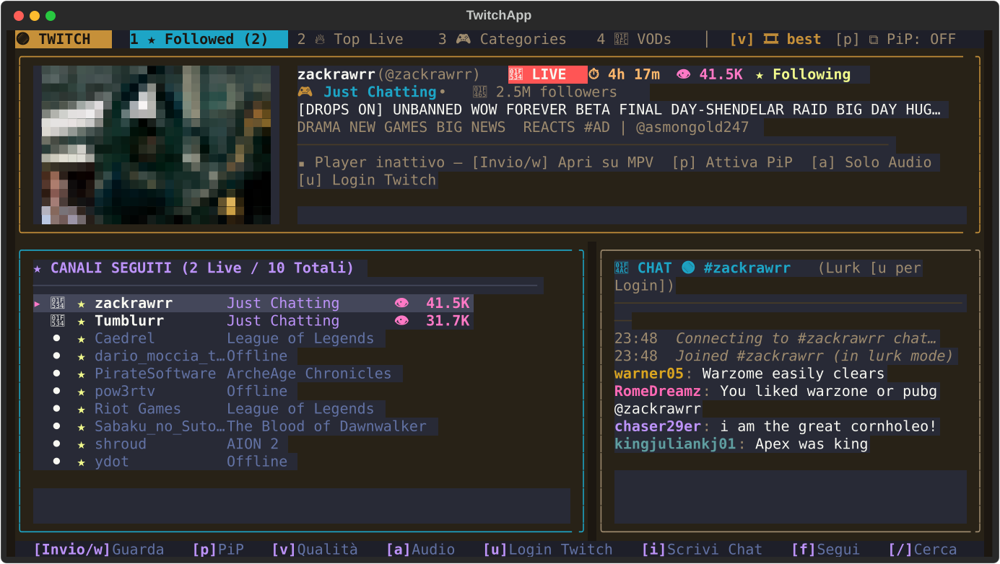
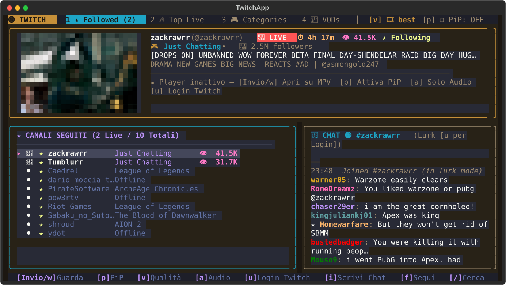
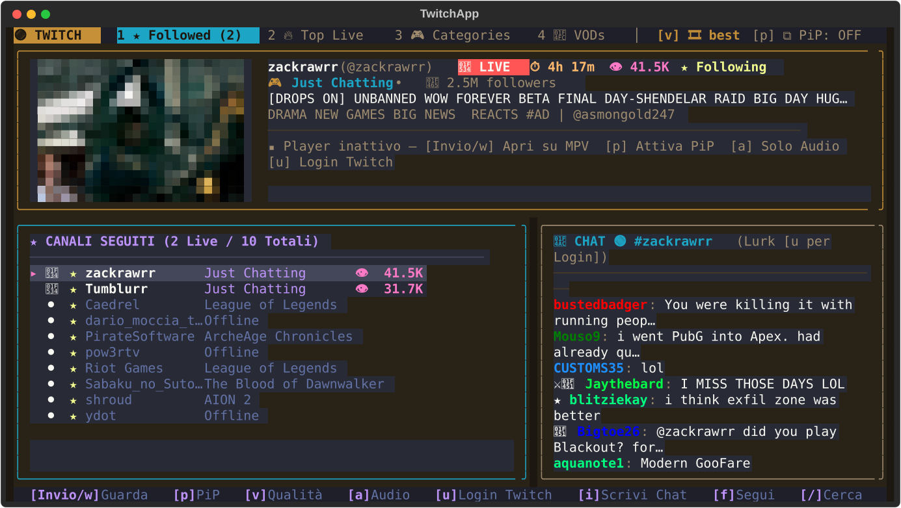

# 🟣 twitch-tui

A lightweight, **Truecolor Terminal UI (TUI)**, **Live IRCv3 Chat**, **Streamlink + MPV IPC Controller**, and **Waybar Widget** for Twitch.

Built with **Python**, **Textual**, **Rich**, and **Pillow**, matching the Dracula & Dynamic Artwork aesthetic of [`yt-music-tui`](https://github.com/LucaPezzato/yt-music-tui).

---

## 📸 Screenshots

### Followed Channels & Live IRC Chat (`[1] ★ Followed`)


### Top Live Streams (`[2] 🔥 Top Live`)


### Top Categories (`[3] 🎮 Categories`)


---

## ✨ Features

- **Hybrid Access (Zero-Config + Optional OAuth)**:
  - Works out of the box **without any API key or login** (queries Twitch's GraphQL API directly and stores your followed channels locally in `~/.config/twitch-tui/config.json`).
  - Optional **OAuth Token** support (`A` in TUI or `twitch-tui auth <token>`): automatically resolves your Twitch username, syncs your followed channels (`S`), and unlocks sending messages in live chat.
- **16:9 Truecolor Live Previews & Dynamic Themes**:
  - Renders live stream thumbnails, channel avatars, and category box art using 24-bit Unicode half-blocks (`▀`).
  - Toggle between **Dracula Twitch** and **Dynamic Stream Artwork** ambient palette with `t`.
- **Streamlink + MPV with IPC Control**:
  - Launches streams in `mpv` via `streamlink` with `--twitch-low-latency` and `--twitch-disable-ads`.
  - Switch quality on the fly (`v`: `best`, `1080p60`, `720p60`, `480p`, `360p`, `audio_only`).
  - Listen in **Audio-Only** background mode (`a`).
  - Control active MPV playback directly from the TUI (`Space` pause/resume, `m` mute, `+`/`-` volume, `x` stop).
- **Integrated Live Twitch Chat (IRCv3 over TLS)**:
  - Side-by-side real-time chat with user colors, subscriber/mod/VIP/broadcaster badges (`📺`, `⚔`, `💎`, `★`, `👑`), system raid/sub alerts, and lurk mode (`l`).
- **Waybar Integration & Desktop Notifications**:
  - `twitch-tui waybar` outputs JSON for Waybar with live followed count, rich tooltip, active MPV status, and sends desktop notifications (`notify-send`) when a followed streamer goes live.

---

## ⌨️ Keybindings

| Key | Action |
| :--- | :--- |
| `1` / `2` / `3` / `4` / `Tab` | Switch tabs: **Followed**, **Top Live**, **Categories**, **VODs** |
| `j` / `k` or `↓` / `↑` | Navigate list (`g` top, `G` bottom) |
| `Enter` / `w` | Watch selected stream/VOD in MPV (and join chat) |
| `a` | Listen in **Audio-Only** background mode |
| `v` | Cycle stream quality (`best`, `1080p60`, `720p60`, `480p`, `360p`, `audio_only`) |
| `f` | Follow / Unfollow selected channel |
| `l` | Join / Lurk live chat of selected channel without opening video |
| `c` | Show / Hide live chat panel |
| `i` | Write a message in live chat (requires OAuth token) |
| `/` | Search any channel on Twitch |
| `A` / `S` | Set Twitch OAuth token (`A`) / Sync followed channels (`S`) |
| `Space` / `m` / `+` / `-` / `x` | Control active MPV stream (Pause, Mute, Volume, Stop) |
| `t` | Toggle Dynamic Artwork Theme / Dracula Theme |
| `o` | Open selected stream/VOD in web browser |
| `r` | Refresh current view |
| `q` | Quit TUI |

---

## 🚀 CLI Usage

```bash
# Open interactive TUI
twitch-tui

# Output Waybar JSON status (and trigger live notifications)
twitch-tui waybar

# Watch a channel directly in MPV
twitch-tui watch shroud --quality 1080p60

# Follow / Unfollow channels from CLI
twitch-tui follow dario_moccia_twitch
twitch-tui list

# Configure optional OAuth token and sync followed channels
twitch-tui auth <YOUR_OAUTH_TOKEN> --sync
```
